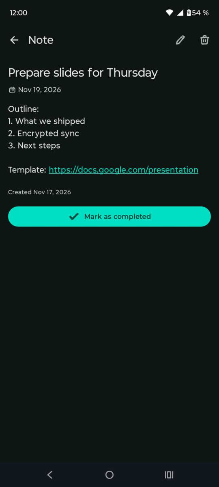
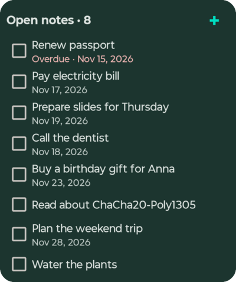
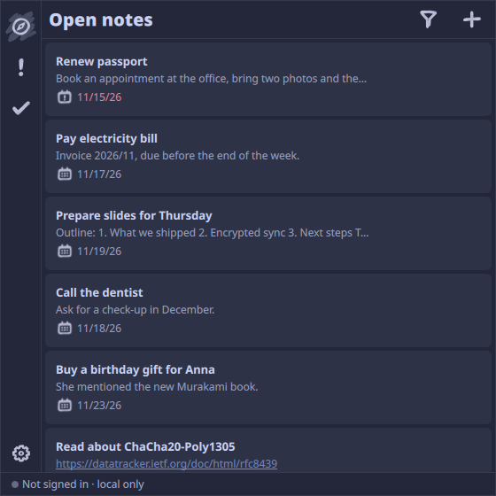
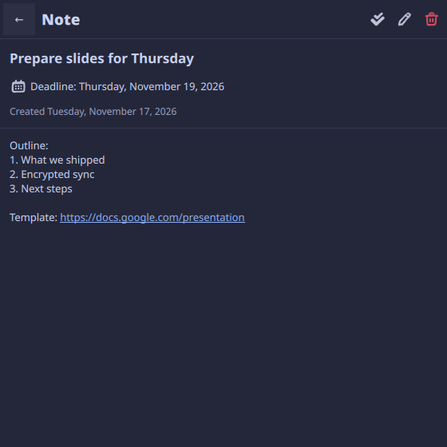
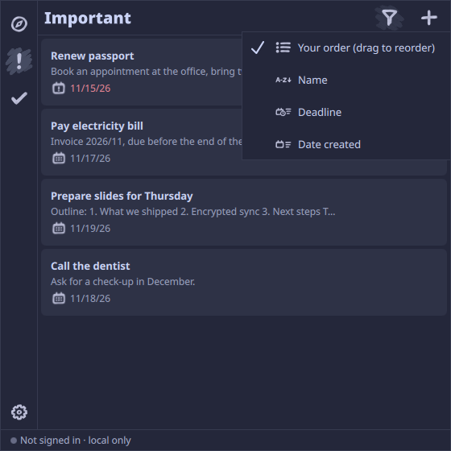
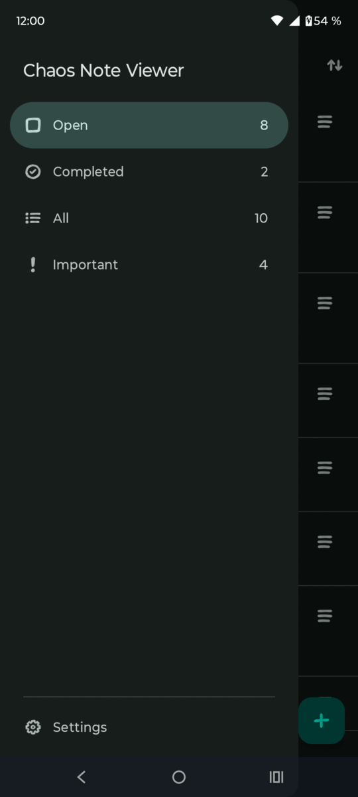
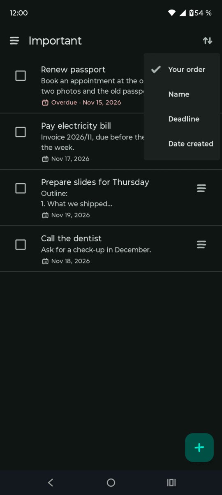
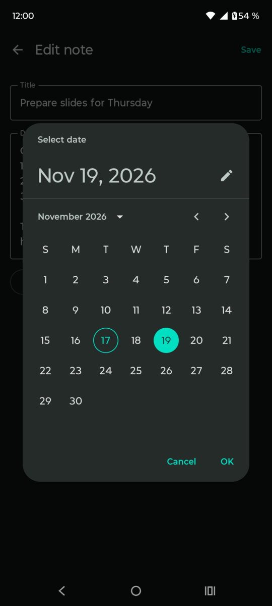
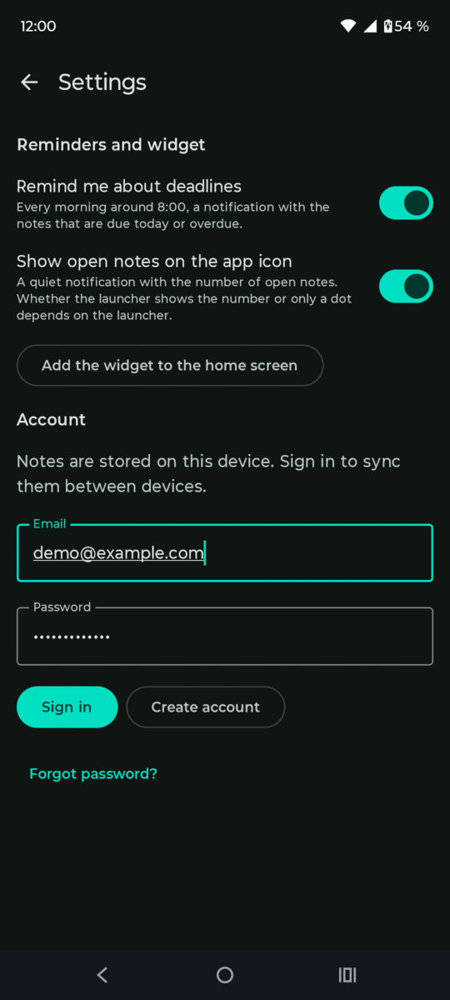
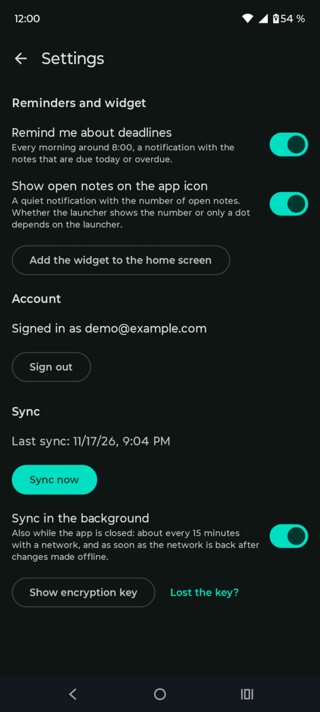

  

<h1 align="center">Chaos Note Viewer</h1>

  Notes with deadlines on your desktop and your phone. Local-first, works offline, 
  and syncs end-to-end encrypted when you sign in.

  
  &nbsp;
  
  &nbsp;
  

## Features

- **Notes with deadlines.** A title, a description with clickable links, and an optional deadline. Overdue notes stand
  out, notes due within three days land in *Important*.
- **Your order or sorted.** Drag notes into your own order, or sort them by name, deadline or creation date.
- **Filters.** Open, completed, all and important notes, each with its count.
- **Local-first.** Notes live in a database on the device. No account and no network needed.
- **Encrypted sync.** Sign in to sync between the desktop and the phone. Notes are encrypted on the device with
  ChaCha20-Poly1305 before they leave it. The key exists only on your devices: the cloud stores ciphertext and never
  the key.
- **Sync that keeps up.** Changes go out a couple of seconds after you make them, the open app pulls every 30 seconds,
  and on Android a background job syncs about every 15 minutes and as soon as the network is back.
- **Home screen widget** (Android) with your open notes and checkboxes to complete them.
- **Daily reminder** (Android) of notes due today or overdue, and the number of open notes on the app icon.
- **KDE Plasma widget and a tray app** for Linux and Windows.

## Screenshots

### Desktop

A tray app for Linux and Windows that pops up above the tray icon, and the same notes as a KDE Plasma widget.

<table>
  <tr>
    <td align="center"> Open notes</td>
    <td align="center"> Editing with a deadline</td>
  </tr>
  <tr>
    <td align="center"> A note with links</td>
    <td align="center"> Important notes, sorting</td>
  </tr>
</table>

### Android

<table>
  <tr>
    <td align="center"> Filters with counts</td>
    <td align="center"> Important notes, sorting</td>
    <td align="center"> Picking a deadline</td>
  </tr>
  <tr>
    <td align="center"> Reminders, widget, account</td>
    <td align="center"> Your encryption key</td>
    <td align="center"> Sync status</td>
  </tr>
</table>

## Get it

| Client | Where |
|---|---|
| Android 9 or newer | APK in [Releases](../../releases), source on the [`android`](../../tree/android/android) branch |
| KDE Plasma 6 widget, tray app for Linux and Windows (Qt 6) | source and build instructions on the [`desktop`](../../tree/desktop/desktop) branch |

## How the encryption works

The first device you sign in on creates a random 256-bit key and shows it to you as text. Other devices ask you to type
it in. Each note is encrypted separately (ChaCha20-Poly1305, its id bound in as associated data), so the server can't
read, swap or mix notes. To tell a wrong key from a right one, the cloud keeps one known text encrypted with your key,
never the key itself. Lose every device and the key, and the notes in the cloud can't be read by anyone, including you.

The format is specified in [core/crypto/](core/crypto/), with test vectors every client is checked against.

## Repository layout

`main` holds what all clients share; each client is developed on its own branch, which gets `main` merged in
automatically.

- [core/firebase/](core/firebase/): Firestore security rules, their tests and the emulator setup
- [core/storage/migrations/](core/storage/migrations/): the local database schema
- [core/crypto/](core/crypto/): the encryption format and test vectors
- [core/assets/](core/assets/): the logo and icons

## License

[GPL-3.0-or-later](LICENSE). Copyright (c) 2026 Emanuel Cisar.

Other licensing terms, for example for use in a closed-source product, are available from the author: open an
[issue](../../issues).
