

  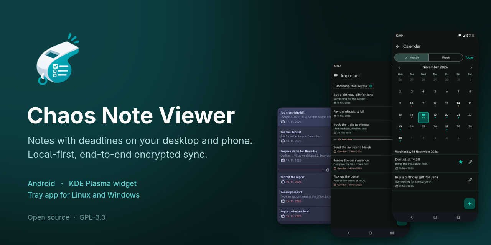

  Notes with deadlines on your desktop and your phone. Local-first, works offline, 
  and syncs end-to-end encrypted when you sign in.

  
  
  
  

  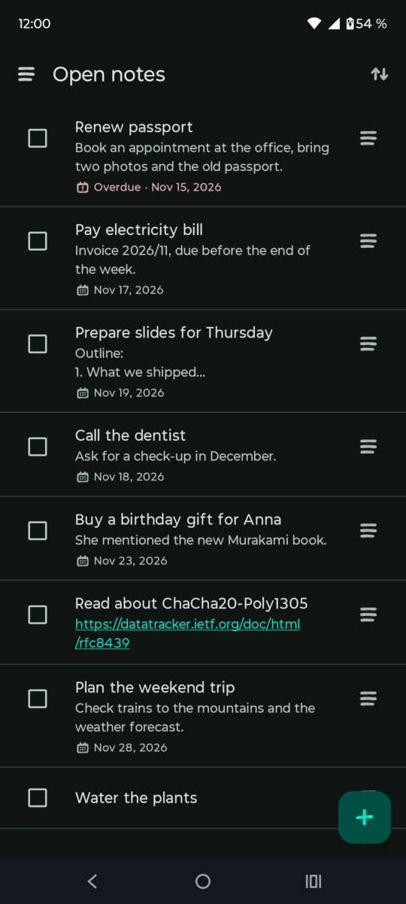
  &nbsp;
  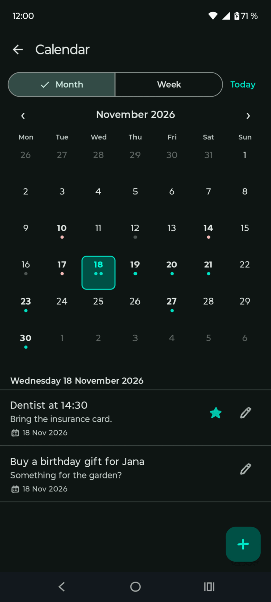
  &nbsp;
  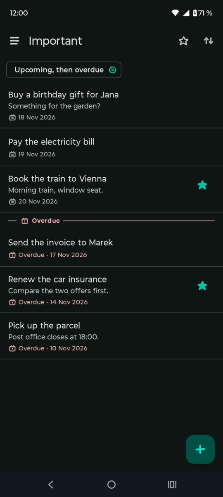

## Features

**Notes**

- **Notes with deadlines.** A title, a description with clickable links, and an optional deadline. Overdue notes stand
  out in red.
- **Swipe to complete.** Pull a note to the left to mark it as done. The row stays in place for a few seconds with an
  **Undo**, so nothing disappears by accident. A tap only ever opens the note.
- **Stars.** Star the notes that matter. Stars sync between your devices, and the *Starred first* switch puts them on
  top of whatever order you chose.
- **Your order or sorted.** Drag notes into your own order, or sort them by name, deadline or creation date.

**Staying on top of deadlines**

- **Important.** Notes that are overdue or due within three days. Upcoming ones come first with the closest deadline on
  top. Overdue ones follow below a red *Overdue* divider. This view remembers its own sort.
- **Calendar.** A month or week view with a dot for every deadline. Pick a day to see what is due, complete it with
  a swipe, or press **+** to add a note due on that day.
- **Reminders** (Android). Every morning around 8:00, one notification for each note due today or overdue, with a
  **Done** button. No permanent "you have N notes" nagging.
- **Filters.** Open, completed, all and important notes, each with its count.

**Your data**

- **Local-first.** Notes live in a database on the device. No account and no network needed.
- **Encrypted sync through your own Firebase project.** Sign in to sync between the desktop and the phone. The cloud
  is a free Firebase project that you create yourself, so your notes are never kept on somebody else's server. Notes
  are encrypted on the device with ChaCha20-Poly1305 before they leave it. The key exists only on your devices: the
  cloud stores ciphertext and never the key.
- **One scan to add a device.** A device that already syncs shows a QR code with the whole setup (your project and
  the encryption key); the new phone scans it and you only sign in.
- **Sync that keeps up.** Changes go out a couple of seconds after you make them, the open app pulls every 30 seconds,
  and on Android a background job syncs about every 15 minutes and as soon as the network is back.

**Everywhere**

- **Android app** with a home screen widget of your open notes.
- **KDE Plasma widget** and a **tray app** for Linux and Windows that pops up above the tray icon.

## Screenshots

### Android

<table>
  <tr>
    <td align="center">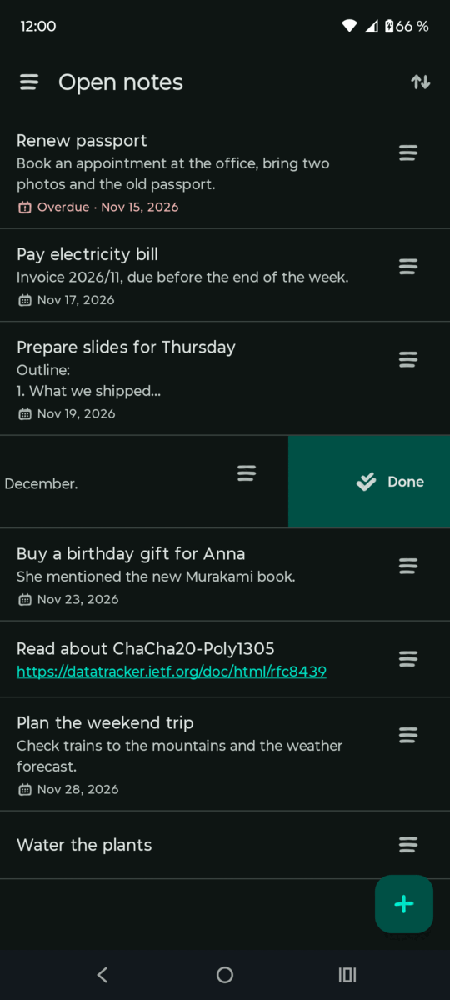 Swipe left to complete</td>
    <td align="center">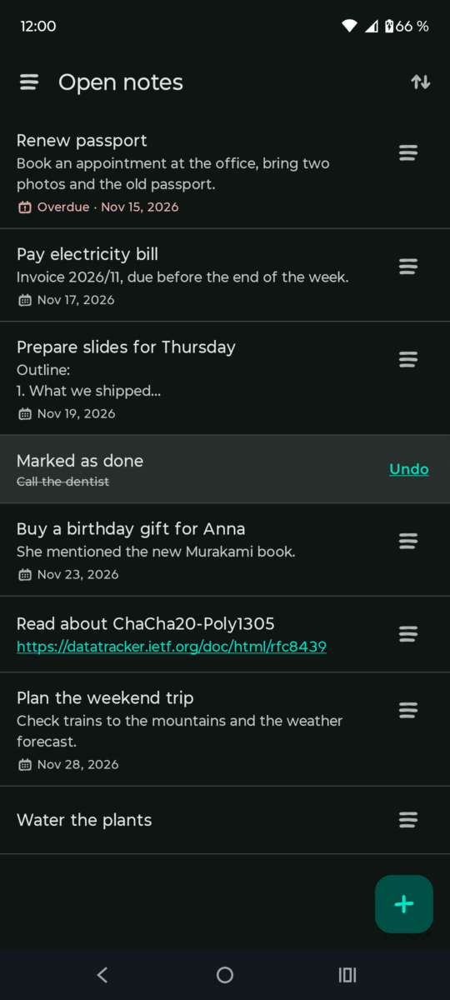 Undo, right where the note was</td>
    <td align="center">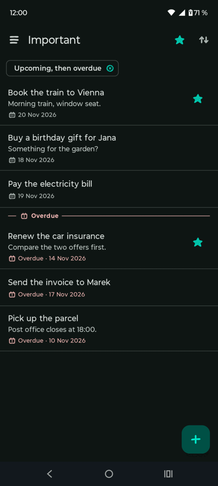 Starred notes first</td>
  </tr>
  <tr>
    <td align="center">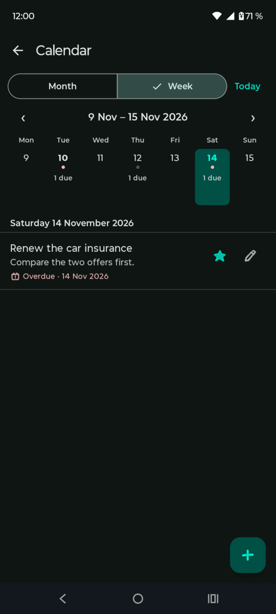 Calendar, week view</td>
    <td align="center">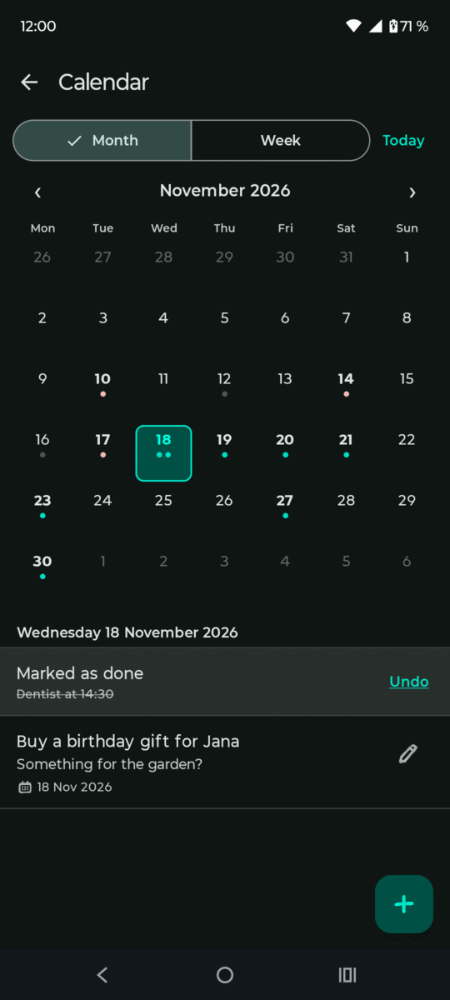 Complete from the calendar</td>
    <td align="center">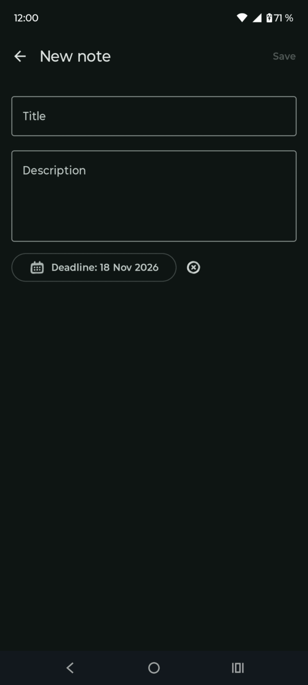 New note on the picked day</td>
  </tr>
  <tr>
    <td align="center">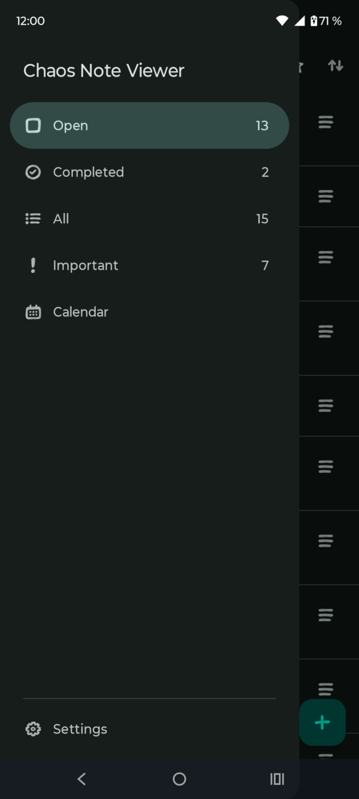 Filters with counts, calendar</td>
    <td align="center">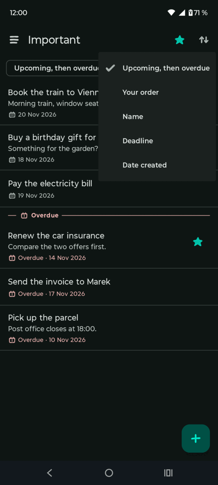 Sorting, per view</td>
    <td align="center"> Picking a deadline</td>
  </tr>
  <tr>
    <td align="center"> Home screen widget</td>
    <td align="center">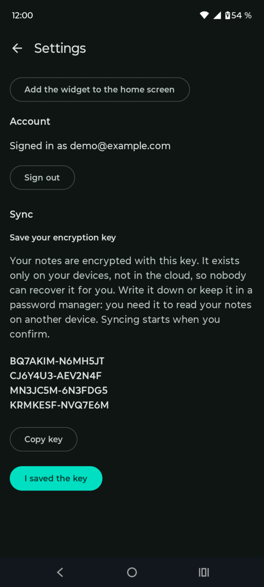 Your encryption key</td>
    <td align="center"> Sync status</td>
  </tr>
</table>

### Desktop

The tray app and the Plasma widget share one interface.

<table>
  <tr>
    <td align="center">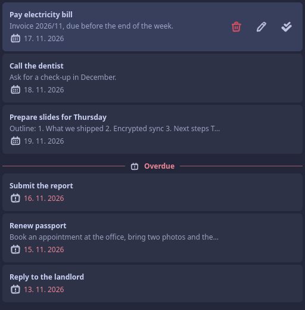 Important: upcoming, then overdue</td>
    <td align="center">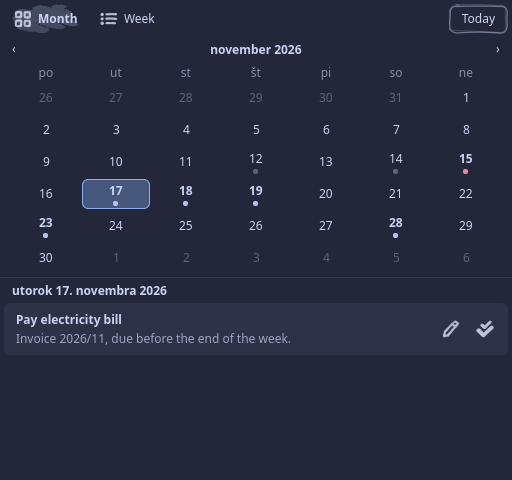 Calendar of deadlines</td>
  </tr>
  <tr>
    <td align="center">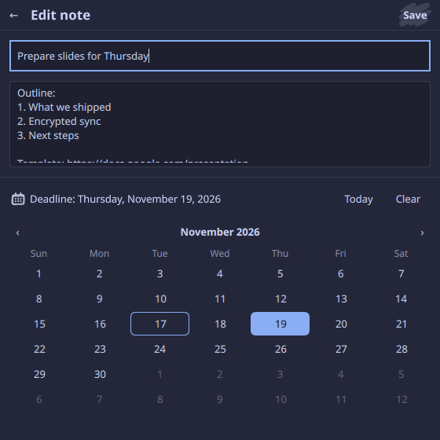 Editing with a deadline</td>
    <td align="center">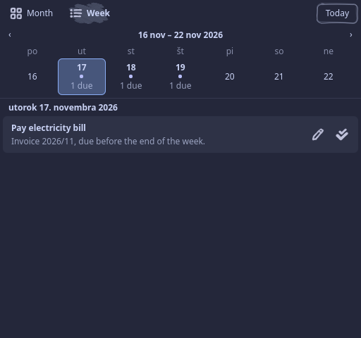 Week view</td>
  </tr>
  <tr>
    <td align="center">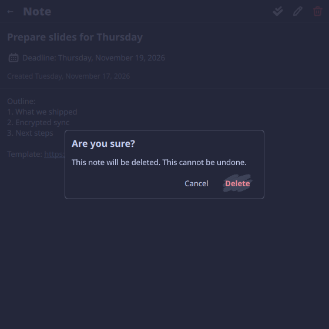 Nothing is deleted without asking</td>
    <td align="center">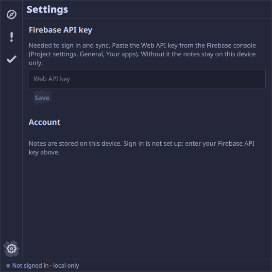 Settings, works without an account</td>
  </tr>
</table>

## Get it

| Client | Where |
|---|---|
| Android 9 or newer | APK in the [Android releases](../../releases?q=android-v&expanded=true) (tags `android-v*`), source on the [`android`](../../tree/android/android) branch |
| Windows, Linux (AppImage, x86_64 and ARM64), KDE Plasma 6 widget | zip, AppImage and `.plasmoid` in the [desktop releases](../../releases?q=desktop-v&expanded=true) (tags `desktop-v*`), source and build instructions on the [`desktop`](../../tree/desktop/desktop) branch |

Each release lists its files and how to install them.

## Sync with your own Firebase project

The apps work fully without it. To sync, every user brings their own Firebase project: nothing of a project is built
into the apps, and no notes ever pass through a server of the author. Firebase's free Spark plan is enough.

**Set up the project once:**

1. Create a project in the [Firebase console](https://console.firebase.google.com/).
2. **Authentication** → Get started → Sign-in method: enable **Email/Password**.
3. **Firestore Database** → Create database. Then, on its **Rules** tab, replace the rules with the contents of
   [core/firebase/firestore.rules](core/firebase/firestore.rules) and press Publish. They let each account read and
   write only its own notes, and only with a verified email.
4. **Project settings** → General: note the **Project ID** and the **Web API key**. (If the key field is empty, add a
   Web app on the same page; its `firebaseConfig` snippet shows the key as `apiKey`.)

**First device:** the apps ask for these two values on first start, or later in Settings (Firebase project). Pasting
the whole `firebaseConfig` snippet into the key field works too. Then create an account, open the link in the
verification email, and the app creates your encryption key: store it somewhere safe.

**Next devices:** on the device that already syncs, open Settings → Show key. It shows a QR code with the project and
the encryption key (the [setup code](core/crypto/README.md#setup-code)). Scan it on the new phone's first start, or
use Copy setup code and paste it on another computer, then sign in with the same email and password. The sign-in is
never part of the code: whoever sees it still needs your password.

The Web API key is not a secret in Firebase's sense (it identifies the project, it grants nothing); what protects your
notes are the security rules, your password and the encryption key.

## How the encryption works

The first device you sign in on creates a random 256-bit key and shows it to you as text and as a QR code. Other
devices ask you to type it in or scan it. Each note is encrypted separately (ChaCha20-Poly1305, its id bound in as associated data), so the server can't
read, swap or mix notes. To tell a wrong key from a right one, the cloud keeps one known text encrypted with your key,
never the key itself. Lose every device and the key, and the notes in the cloud can't be read by anyone, including you.

The format is specified in [core/crypto/](core/crypto/), with test vectors every client is checked against.

## Repository layout

`main` holds what all clients share; each client is developed on its own branch, which gets `main` merged in
automatically.

- [core/firebase/](core/firebase/): Firestore security rules, their tests and the emulator setup
- [core/storage/migrations/](core/storage/migrations/): the local database schema
- [core/crypto/](core/crypto/): the encryption format and test vectors
- [core/assets/](core/assets/): the logo and icons

## Contributing

Bug reports and ideas are welcome in [issues](../../issues). For a pull request, open an issue first so we can agree
on the change. Contributions are accepted under the project's license.

## License

[GPL-3.0-or-later](LICENSE). Copyright (c) 2026 Emanuel Cisar.

Other licensing terms, for example for use in a closed-source product, are available from the author: open an
[issue](../../issues).
